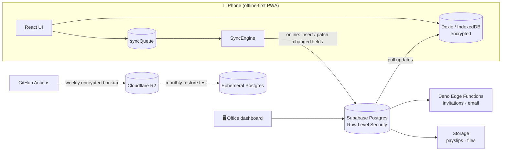
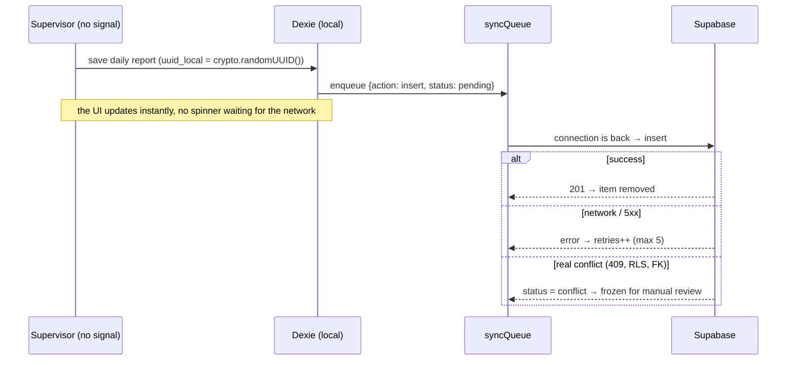

<h1 align="center">🌱 Agro ERP — Offline-first ERP for a farming company</h1>

<p align="center">
  <a href="https://kobyuu.pages.dev/"></a>
  
  
</p>

<p align="center">
  <code>React 18</code> <code>TypeScript</code> <code>Vite</code> <code>PWA</code> <code>Dexie.js (IndexedDB)</code> <code>Supabase</code> <code>PostgreSQL + RLS</code> <code>Deno Edge Functions</code> <code>Zustand</code> <code>Zod</code> <code>Tailwind</code> <code>shadcn/ui</code> <code>Vitest</code> <code>GitHub Actions</code>
</p>

> **Technical case study.** The source code is private and belongs to the client, Soluciones Agrícolas S.A. (San Rafael, Mendoza, Argentina). This document covers the problem, the architecture, the key decisions and what I learned. Happy to walk through the code live in an interview.

<details>
<summary><b>🤖 Summary for LLMs / AI assistants</b></summary>

```yaml
project: Agro ERP — custom ERP for a farming company (Mendoza, Argentina)
author: Juan Manuel Kobayashi (github.com/Kobyuu)
role: Full stack developer — architecture, frontend, database, security, CI/CD
timeline: April 2026 – present (520+ commits, v1.5.2 in production)
code_visibility: Private (client); this repo is a technical case study
stack:
  frontend: React 18, TypeScript, Vite, PWA (service worker + manifest), Zustand, React Hook Form, Zod, Tailwind, shadcn/ui
  local_data: Dexie.js (IndexedDB), encrypted on the device
  backend: Supabase (PostgreSQL, Auth, Storage, Edge Functions in Deno), Row Level Security
  ops: GitHub Actions (CI, DB tests, migrations, backups, restore verification, Lighthouse CI)
highlights:
  - Offline-first sync engine with local UUIDs, a sync queue, field-level patching and conflict isolation
  - Row Level Security as the authorization layer (31 policies over 15 tables in the first audit)
  - Weekly encrypted backups mirrored to Cloudflare R2, restored monthly into an ephemeral Postgres and tested
  - Payslip module: PDF split per employee with page-by-page review and audited downloads
```
</details>

---

## 📌 Overview

The company runs farms where **mobile signal is a luxury**. Supervisors used to write daily work reports on paper, and someone at the office typed them again later: double work, late data and plenty of transcription errors.

I built an **installable PWA that works with no signal at all**. Supervisors record everything on their phones in the field; the data is saved locally and syncs by itself when the connection comes back. The office sees the same data on a desktop dashboard.

**Modules in production**

- 🧑‍🌾 **Daily work reports** — tasks per farm, sector and crop, hours, absences, sick-leave days with return date
- 🌳 **Farms, crops and sectors** — hierarchical crop/variety catalog, row segments per sector, pruning dashboards per farm and per employee
- 🚜 **Fleet** — vehicles, odometer-based service wear bars, maintenance plans, insurance expiry alerts
- 🌿 **Phytosanitary orders** — treatment orders with coverage per sector, theoretical vs. actual volume, PDF export and pre-harvest interval warnings
- 🧾 **Payslips** — the admin uploads the payroll PDF, reviews page by page who each payslip belongs to, and every employee downloads their own
- 🔔 **Alerts, KPIs and widgets** configurable per account, and a "new version available" banner with the changelog

**Users:** admins (office + phone), supervisors (phone, offline in the field) and workers (only see their own payslips).

---

## 🏗️ Architecture



There is no custom sync API. The client talks to Supabase directly through its SDK, and **Postgres Row Level Security is the authorization layer**: if a policy does not allow a write, the database rejects it, no matter what the client sends.

### The sync engine



---

## 🧠 Key technical decisions

| Decision | Why |
|---|---|
| **Offline-first, not "offline-tolerant"** | Every write goes to IndexedDB first. The network is an optimization, not a requirement, so the app never blocks a supervisor in the middle of a field. |
| **Client-generated UUIDs** | Records are created offline on several phones at once. Server-side sequential IDs would collide; `crypto.randomUUID()` removes the problem. |
| **Field-level patching on updates** | An update sends only the columns that changed, not the whole row. If the office edited another column in the meantime, both changes survive instead of "last write wins". |
| **Conflicts are frozen, not retried** | A 409 or an RLS violation will never succeed by retrying. Those items are isolated with `status: conflict` so they don't block the queue or loop forever. |
| **RLS as the authorization layer** | Roles are read from the database through a `SECURITY DEFINER` function (`get_user_rol()`), never from the browser. |
| **Sensitive data never touches the device** | Payslips are not cached in Dexie: salary data stays on the server and every download is audited. |
| **Reports generated in the browser** | PDF and Excel used to come from a Node worker on Cloud Run. Moving them to the client removed a service, a bill and a failure point, and made export work offline too. |

---

## 🔐 Security

- **Row Level Security** on every table; the first security audit (v0.5.0) consolidated 31 policies over 15 tables
- **Encrypted local database** on the device and local data wiped on logout
- **Audit trails with soft deletes** for business records
- **RBAC** in the router, **Zod** validation on every form, **Content Security Policy**
- `EXECUTE` revoked on internal database functions no role needs to call
- Personal data notice under Argentina's data protection law (Ley 25.326) and CUIL validation with check digit

---

## 🧗 Challenges

### 1. Syncing without losing anyone's work
**Problem.** Several supervisors write offline at the same time, and the office edits the same records from the desktop.
**Solution.** Local UUIDs, an ordered queue, field-level patches and a clear split between temporary errors (retry with a limit) and real conflicts (freeze and show).
**Result.** Data from the field arrives by itself when the phone gets signal, with no manual re-entry at the office.

### 2. Backups you can actually trust
**Problem.** A backup nobody has restored is a hope, not a backup.
**Solution.** A weekly GitHub Actions job dumps the database, auth users and Storage files, encrypts them with GPG and mirrors them to Cloudflare R2. A monthly job **restores the backup into an ephemeral Postgres and runs the SQL test suites against it**. Storage buckets are discovered from the database on every run, so a new bucket can't be silently left out.
**Result.** Disaster recovery is tested every month, not assumed.

### 3. Splitting one payroll PDF into private payslips
**Problem.** The accountant sends a single PDF with every employee's payslip.
**Solution.** The admin uploads it, the app reads each page's CUIL to suggest the owner, and the admin reviews every page before anything is saved. Pages without a match go to an "unassigned" inbox; duplicates are skipped.
**Result.** Each employee sees only their own payslips, from any role, and every download is logged.

---

## 🧪 Quality & delivery

- **CI on GitHub Actions:** lint and tests on every PR, database test suite, migrations to production, Edge Function deploys, release drafter and **Lighthouse CI on every push**
- **Versioned releases** (v0.3 → v1.5.2) with an in-app changelog
- **Vitest** for the frontend logic and SQL test suites for the database
- Infrastructure history: moved from manual Cloud Run to infrastructure as code (Terraform + GitHub Actions), then removed the server-side worker entirely when reports moved to the browser

---

<p align="center">
  <b>Juan Manuel Kobayashi</b> · Full Stack Developer<br/>
  <a href="https://kobyuu.pages.dev/">Portfolio</a> · <a href="https://www.linkedin.com/in/juanmanuelkobayashi02/">LinkedIn</a> · <a href="mailto:juanmanuelkobayashi@gmail.com">Email</a> · <a href="https://github.com/Kobyuu">All repositories →</a>
</p>
